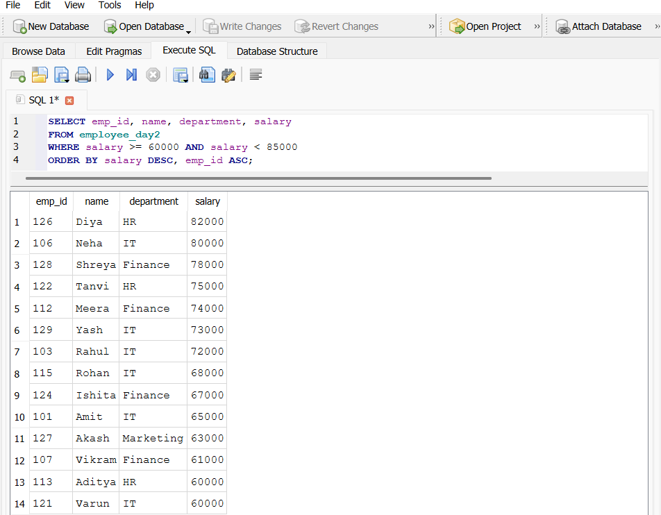
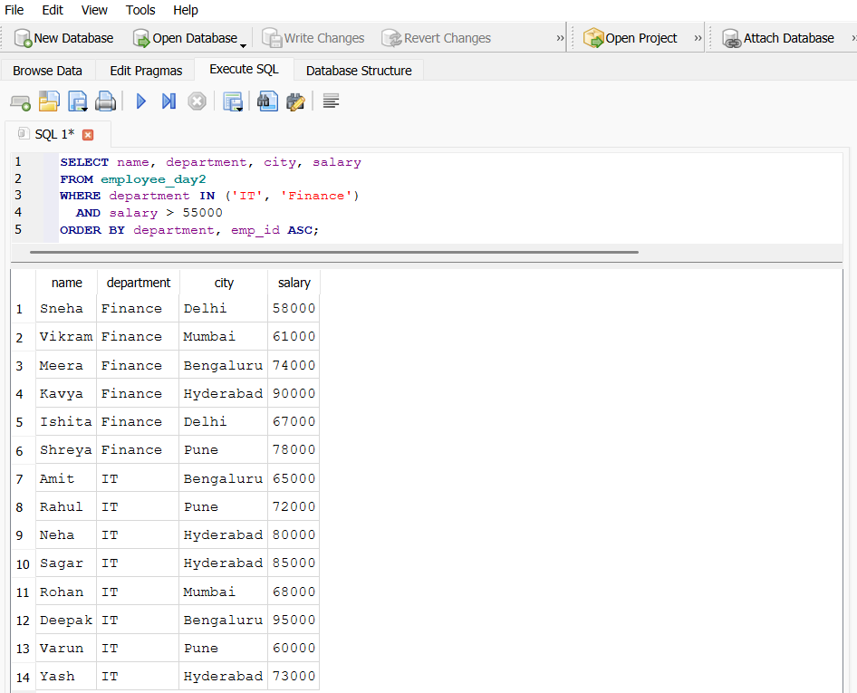
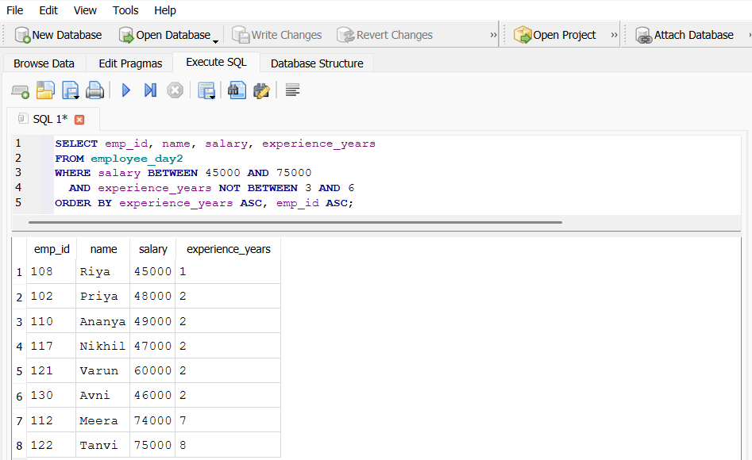
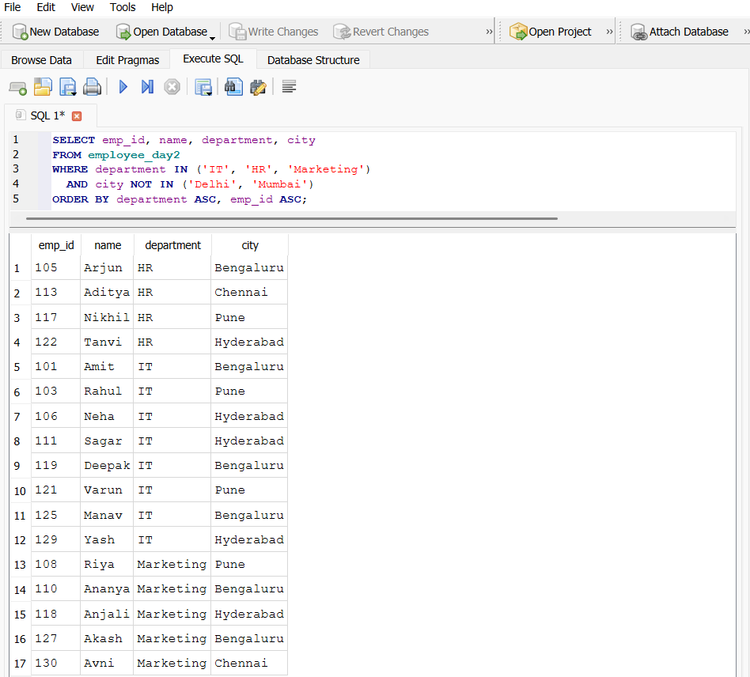
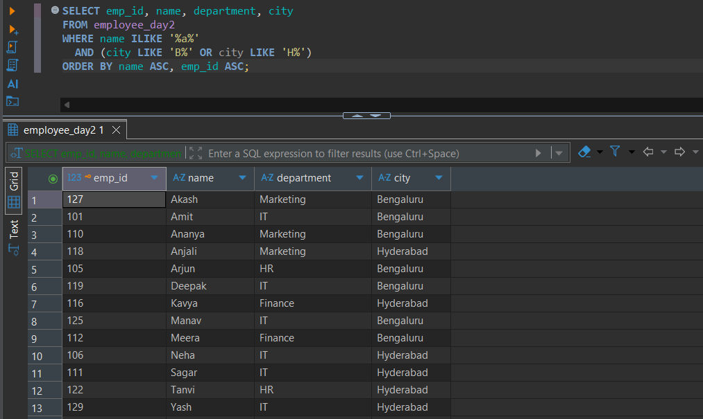

# Day 02: SQL Practice Answers

**Date:** 15 October 2026  
**Database:** PostgreSQL 18  
**Tool:** pgAdmin 4  
**Topic:** Comparison Operators, Logical Operators, BETWEEN, NOT BETWEEN, IN, NOT IN, LIKE, NOT LIKE  
**Table:** `employee_day2`

---

## 1. Retrieve the employee ID, name, department, and salary of employees whose salary is greater than or equal to 60,000 and less than 85,000. Sort the results by salary in descending order and employee ID in ascending order.

**SQL Query**

```sql
SELECT emp_id, name, department, salary
FROM employee_day2
WHERE salary >= 60000 AND salary < 85000
ORDER BY salary DESC, emp_id ASC;
```

**Execution Output**



---

## 2. Retrieve the name, department, city, and salary of employees who belong to either the IT or Finance department and earn more than 55,000. Use parentheses to ensure the intended logical grouping. Sort the results by department and employee ID in ascending order.

**SQL Query**

```sql
SELECT name, department, city, salary
FROM employee_day2
WHERE department IN ('IT', 'Finance')
  AND salary > 55000
ORDER BY department, emp_id ASC;
```

**Execution Output**



---

## 3. Retrieve the employee ID, name, salary, and experience years of employees whose salary is between 45,000 and 75,000 (inclusive), but whose experience is not between 3 and 6 years (inclusive). Sort the results by experience years in ascending order, followed by employee ID.

**SQL Query**

```sql
SELECT emp_id, name, salary, experience_years
FROM employee_day2
WHERE salary BETWEEN 45000 AND 75000
  AND experience_years NOT BETWEEN 3 AND 6
ORDER BY experience_years ASC, emp_id ASC;
```

**Execution Output**



---

## 4. Retrieve the employee ID, name, department, and city of employees who work in IT, HR, or Marketing but are not located in Delhi or Mumbai. Sort the results by department, then employee ID, in ascending order.

**SQL Query**

```sql
SELECT emp_id, name, department, city
FROM employee_day2
WHERE department IN ('IT', 'HR', 'Marketing')
  AND city NOT IN ('Delhi', 'Mumbai')
ORDER BY department ASC, emp_id ASC;
```

**Execution Output**



---

## 5. Retrieve the employee ID, name, department, and city of employees whose names contain the letter a anywhere, regardless of case, and whose cities start with either B or H. Use PostgreSQL pattern matching and logical operators. Sort the results alphabetically by name, followed by employee ID.

**SQL Query**

```sql
SELECT emp_id, name, department, city
FROM employee_day2
WHERE name ILIKE '%a%'
  AND (city LIKE 'B%' OR city LIKE 'H%')
ORDER BY name ASC, emp_id ASC;
```

**Execution Output**



---

## Session Notes

**Concepts Practiced:** Comparison Operators, Logical Operators, BETWEEN, NOT BETWEEN, IN, NOT IN, LIKE, NOT LIKE, ILIKE, WHERE, ORDER BY

### Additional Notes

- `--` marks a single-line SQL comment; commented statements must be uncommented before execution.
- Comparison operators such as `=`, `<>`, `>`, `<`, `>=`, and `<=` are used to filter records.
- `AND`, `OR`, and `NOT` combine or negate filtering conditions.
- Use parentheses to explicitly group logical conditions when necessary.
- `BETWEEN` includes both boundary values. Use `>=` and `<` when the upper boundary must be excluded.
- `NOT BETWEEN` selects values outside the specified range.
- `IN` checks whether a value matches one of several specified values.
- `NOT IN` excludes specified values, but requires care when `NULL` is involved.
- `LIKE` supports pattern matching using `%` for zero or more characters and `_` for exactly one character.
- PostgreSQL supports `ILIKE` for case-insensitive pattern matching.
- `LIKE 'A%'` matches values beginning with A, whereas `LIKE '%A%'` matches values containing A anywhere.
- `ORDER BY` supports multiple columns and explicit sorting directions.
- Use the correct table name (`employee_day2`) when executing the queries.

---
