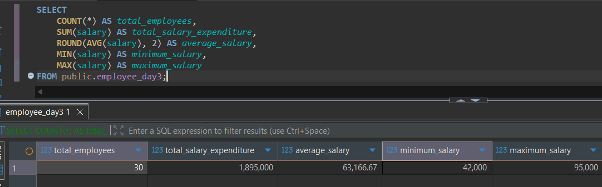
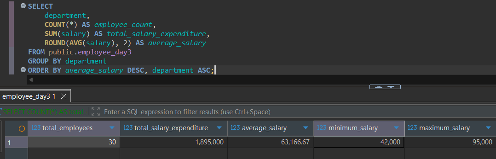
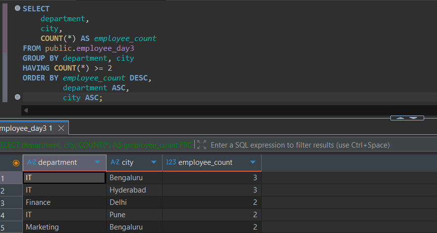
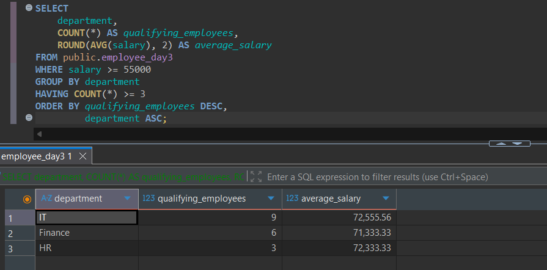
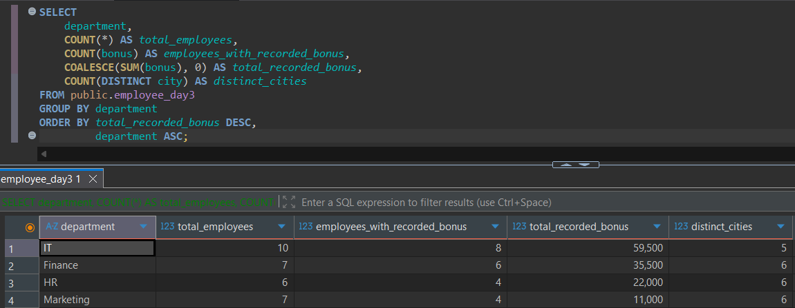

# Day 03: SQL Practice Answers

**Date:** 16 October 2026  
**Database:** PostgreSQL 18  
**Tool:** DBeaver  
**Topic:** COUNT, SUM, AVG, MIN, MAX, DISTINCT with Aggregates, GROUP BY, HAVING, WHERE vs HAVING, NULL Handling
**Table:** `employee_day3`

---

## 1. Retrieve a single summary row showing the total number of employees, total salary expenditure, average salary rounded to two decimal places, minimum salary, and maximum salary. Use meaningful column aliases.

**SQL Query**

```sql
SELECT
    COUNT(*) AS total_employees,
    SUM(salary) AS total_salary_expenditure,
    ROUND(AVG(salary), 2) AS average_salary,
    MIN(salary) AS minimum_salary,
    MAX(salary) AS maximum_salary
FROM public.employee_day3;
```

**Execution Output**



---

## 2. Retrieve each department's name, employee count, total salary expenditure, and average salary rounded to two decimal places. Sort by average salary in descending order and department in ascending order to break ties.

**SQL Query**

```sql
SELECT
    department,
    COUNT(*) AS employee_count,
    SUM(salary) AS total_salary_expenditure,
    ROUND(AVG(salary), 2) AS average_salary
FROM public.employee_day3
GROUP BY department
ORDER BY average_salary DESC, department ASC;
```

**Execution Output**



---

## 3. Retrieve the department, city, and employee count for each department-city combination that contains at least two employees. Sort by employee count in descending order, then department and city in ascending order.

**SQL Query**

```sql
SELECT
    department,
    city,
    COUNT(*) AS employee_count
FROM public.employee_day3
GROUP BY department, city
HAVING COUNT(*) >= 2
ORDER BY employee_count DESC,
         department ASC,
         city ASC;
```

**Execution Output**



---

## 4. Consider only employees earning at least 55,000. Retrieve each department's name, the number of qualifying employees, and their average salary rounded to two decimal places. Include only departments having at least three qualifying employees. Sort by qualifying employee count in descending order, then department in ascending order. Use both WHERE and HAVING.

**SQL Query**

```sql
SELECT
    department,
    COUNT(*) AS qualifying_employees,
    ROUND(AVG(salary), 2) AS average_salary
FROM public.employee_day3
WHERE salary >= 55000
GROUP BY department
HAVING COUNT(*) >= 3
ORDER BY qualifying_employees DESC,
         department ASC;
```

**Execution Output**



---

## 5. For each department, retrieve the department name, total employee count, number of employees with a recorded (non-NULL) bonus, total recorded bonus (display zero if no bonuses are recorded), and number of distinct cities represented. Sort by total recorded bonus in descending order, then department in ascending order.

**SQL Query**

```sql
SELECT
    department,
    COUNT(*) AS total_employees,
    COUNT(bonus) AS employees_with_recorded_bonus,
    COALESCE(SUM(bonus), 0) AS total_recorded_bonus,
    COUNT(DISTINCT city) AS distinct_cities
FROM public.employee_day3
GROUP BY department
ORDER BY total_recorded_bonus DESC,
         department ASC;
```

**Execution Output**



---

## Session Notes

**Concepts Practiced:** 
- Aggregate functions: `COUNT()`, `SUM()`, `AVG()`, `MIN()`, and `MAX()`
- Differences between `COUNT(*)`, `COUNT(column)`, and `COUNT(DISTINCT column)`
- `GROUP BY` with one or multiple columns
- `HAVING` and its distinction from `WHERE`
- Filtering rows before grouping and filtering groups after aggregation
- NULL behavior in aggregate functions
- `COALESCE()` for presenting missing aggregate totals
- `DISTINCT` inside aggregate functions
- Sorting grouped results with `ORDER BY` and deterministic tie-breakers


### Additional Notes

- `WHERE` filters individual rows before grouping and aggregation.
- `GROUP BY` groups rows sharing the same values in one or more specified columns.
- `HAVING` filters groups after aggregation, whereas `WHERE` filters individual rows before aggregation.
- `WHERE` cannot directly use aggregate functions such as `COUNT()`, `SUM()`, or `AVG()`.
- `HAVING` supports aggregate conditions such as `HAVING COUNT(*) >= 3`.
- `COUNT(*)` counts all rows, whereas `COUNT(column)` ignores `NULL` values.
- `SUM()` calculates the total, while `AVG()` calculates the arithmetic mean of non-`NULL` values.
- `MIN()` and `MAX()` return the smallest and largest non-`NULL` values, respectively.
- `ROUND(AVG(salary), 2)` rounds the calculated average salary to two decimal places.
- `GROUP BY department` creates one group for each distinct department.
- `GROUP BY department, city` creates groups for each unique department-city combination.
- In grouped queries, selected columns generally must appear in `GROUP BY` or be used inside aggregate functions, unless PostgreSQL recognizes a valid functional dependency.
- `WHERE salary >= 70000` filters employees earning at least 70,000 before grouping.
- `HAVING AVG(salary) >= 70000` filters groups whose average salary is at least 70,000.
- `WHERE` and `HAVING` can be combined to filter individual records first and then filter the resulting groups.
- The simplified logical processing order is `FROM → WHERE → GROUP BY → HAVING → SELECT → ORDER BY`.
- `COUNT(DISTINCT city)` counts unique non-`NULL` cities within each group.
- `COALESCE(SUM(bonus), 0)` replaces a `NULL` aggregate result with `0`.
- `NULL` bonus values are ignored by `SUM(bonus)` and `AVG(bonus)`, but the corresponding employees are still counted by `COUNT(*)`.
- `GROUP BY` does not guarantee sorted results; use `ORDER BY` for explicit sorting.
- Use the correct table name (`employee_day3`) when executing Day 03 queries.

---

---
