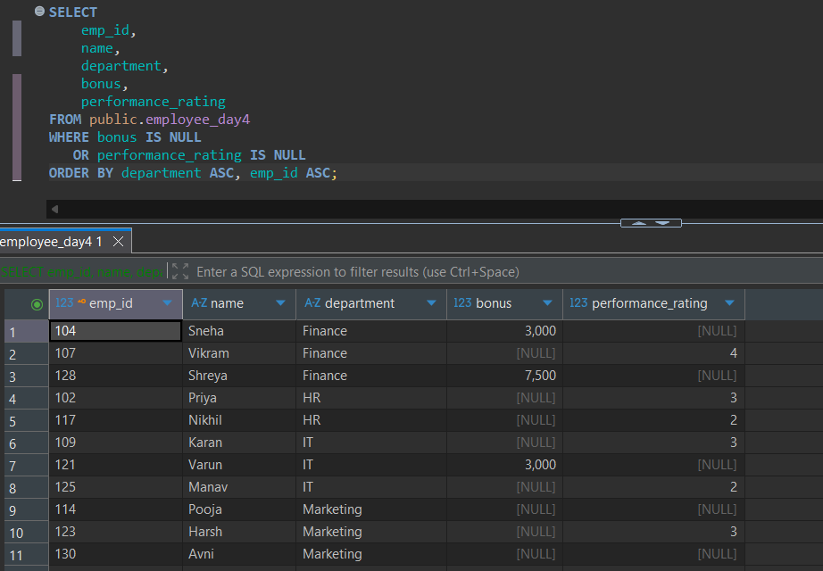
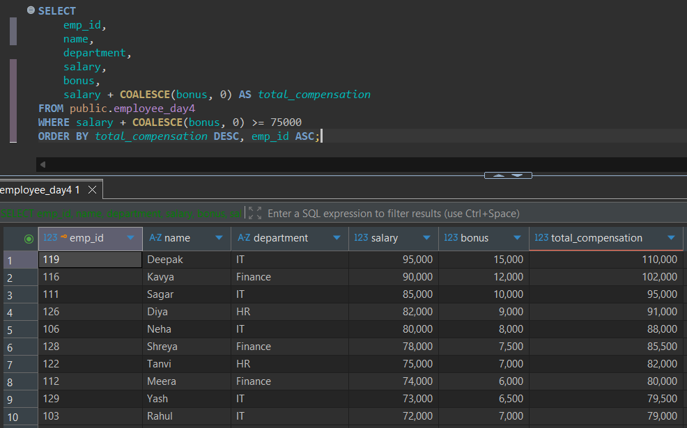
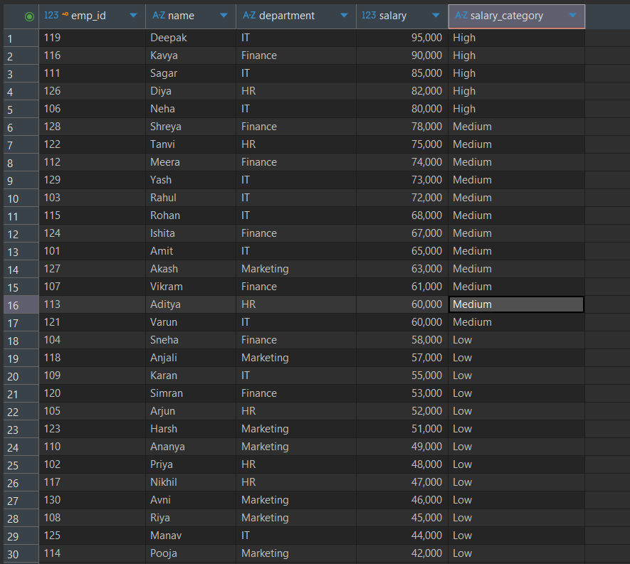
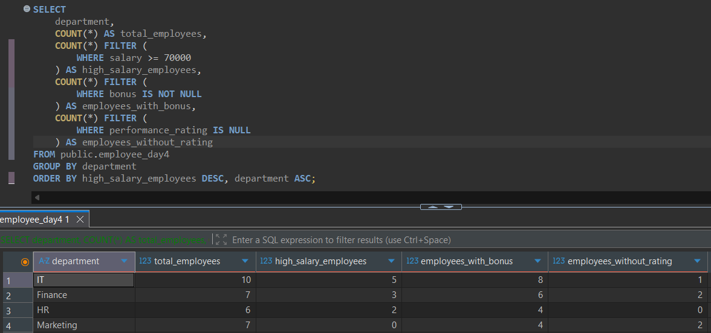
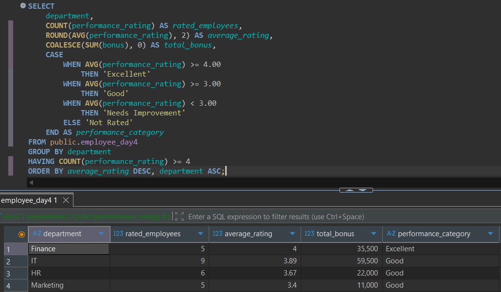

---
# Day 04: SQL Practice Answers

**Date:** 17 October 2026  
**Database:** PostgreSQL 18  
**Tool:** DBeaver  
**Topic:** NULL Handling, CASE Expressions & Conditional Logic  
**Table:** `employee_day4`

---

## 1. Identify employees with missing compensation or performance information.

Retrieve `emp_id`, `name`, `department`, `bonus`, and `performance_rating` for employees whose bonus or performance rating is `NULL`.

Sort the results by `department ASC`, followed by `emp_id ASC`.

**SQL Query**

```sql
SELECT
    emp_id,
    name,
    department,
    bonus,
    performance_rating
FROM public.employee_day4
WHERE bonus IS NULL
   OR performance_rating IS NULL
ORDER BY department ASC, emp_id ASC;
```

**Execution Output**



---

## 2. Calculate employee compensation using COALESCE().

Retrieve `emp_id`, `name`, `department`, `salary`, `bonus`, and a calculated column named `total_compensation`.

Calculate total compensation as salary plus bonus, treating missing bonuses as zero without modifying the original table.

Display only employees with total compensation of at least 75,000.

Sort by `total_compensation DESC`, then `emp_id ASC`.

**SQL Query**

```sql
SELECT
    emp_id,
    name,
    department,
    salary,
    bonus,
    salary + COALESCE(bonus, 0) AS total_compensation
FROM public.employee_day4
WHERE salary + COALESCE(bonus, 0) >= 75000
ORDER BY total_compensation DESC, emp_id ASC;
```

**Execution Output**



---

## 3. Categorize employees using CASE expressions.

Retrieve `emp_id`, `name`, `department`, `salary`, and a calculated column named `salary_category`.

Apply these classifications:

| Condition | Salary Category |
|---|---|
| Salary >= 80000 | High |
| Salary >= 60000 and < 80000 | Medium |
| Salary < 60000 | Low |

Sort by `salary DESC`, followed by `emp_id ASC`.

**SQL Query**

```sql
SELECT
    emp_id,
    name,
    department,
    salary,
    CASE
        WHEN salary >= 80000 THEN 'High'
        WHEN salary >= 60000 AND salary < 80000 THEN 'Medium'
        ELSE 'Low'
    END AS salary_category
FROM public.employee_day4
ORDER BY salary DESC, emp_id ASC;
```

**Execution Output**



---

## 4. Calculate department-wise employee statistics using conditional aggregation.

For each department, retrieve:

- `department`
- `total_employees`
- `high_salary_employees` — employees earning at least 70,000
- `employees_with_bonus` — employees whose bonus is not NULL
- `employees_without_rating` — employees whose performance rating is NULL

Use aggregate functions with `CASE` expressions or PostgreSQL's `FILTER` clause.

Sort by `high_salary_employees DESC`, then `department ASC`.

**SQL Query**

```sql
SELECT
    department,
    COUNT(*) AS total_employees,
    COUNT(*) FILTER (
        WHERE salary >= 70000
    ) AS high_salary_employees,
    COUNT(*) FILTER (
        WHERE bonus IS NOT NULL
    ) AS employees_with_bonus,
    COUNT(*) FILTER (
        WHERE performance_rating IS NULL
    ) AS employees_without_rating
FROM public.employee_day4
GROUP BY department
ORDER BY high_salary_employees DESC, department ASC;
```

**Execution Output**



---

## 5. Analyze performance ratings and compensation by department.

For each department, retrieve:

- `department`
- `rated_employees` — number of employees with a recorded performance rating
- `average_rating` — average of non-NULL ratings, rounded to two decimal places
- `total_bonus` — sum of recorded bonuses, displaying zero if the sum is NULL
- `performance_category` — classification based on average recorded rating

| Average Rating | Performance Category |
|---|---|
| >= 4.00 | Excellent |
| >= 3.00 and < 4.00 | Good |
| < 3.00 | Needs Improvement |
| No recorded ratings | Not Rated |

Include only departments having at least four employees with recorded performance ratings.

Sort by `average_rating DESC`, followed by `department ASC`.

**SQL Query**

```sql
SELECT
    department,
    COUNT(performance_rating) AS rated_employees,
    ROUND(AVG(performance_rating), 2) AS average_rating,
    COALESCE(SUM(bonus), 0) AS total_bonus,
    CASE
        WHEN AVG(performance_rating) >= 4.00
            THEN 'Excellent'
        WHEN AVG(performance_rating) >= 3.00
            THEN 'Good'
        WHEN AVG(performance_rating) < 3.00
            THEN 'Needs Improvement'
        ELSE 'Not Rated'
    END AS performance_category
FROM public.employee_day4
GROUP BY department
HAVING COUNT(performance_rating) >= 4
ORDER BY average_rating DESC, department ASC;
```

**Execution Output**



---

## Session Notes

- Practiced identifying missing values using `IS NULL` and `IS NOT NULL`.
- Used `COALESCE()` to replace missing bonus values during compensation calculations.
- Implemented salary classifications using searched `CASE` expressions.
- Practiced conditional aggregation using PostgreSQL's `FILTER` clause.
- Combined `COUNT()`, `AVG()`, `SUM()`, and `ROUND()` for departmental statistics.
- Used `GROUP BY` to summarize records and `HAVING` to filter aggregated groups.
- Applied multiple-column sorting using `ORDER BY`.

### Additional Notes

- `NULL` represents missing or unknown information and is different from zero or an empty string.
- `IS NULL` identifies missing values, whereas `IS NOT NULL` identifies non-NULL values.
- Ordinary comparisons such as `= NULL` and `<> NULL` do not correctly test for missing values.
- `COALESCE(bonus, 0)` substitutes zero during calculations without modifying stored data.
- `NULLIF(a, b)` returns `NULL` when both arguments are equal; otherwise, it returns `a`.
- `CASE WHEN` evaluates conditions in order and returns the result associated with the first matching condition.
- `ELSE` provides a fallback value when no `WHEN` condition matches.
- `COUNT(*)` includes every row, whereas `COUNT(column)` excludes NULL values.
- `COUNT(*) FILTER (WHERE condition)` counts only records satisfying the specified condition.
- `FILTER` applies a condition to a particular aggregate rather than filtering all rows from the query.
- `SUM(CASE WHEN condition THEN 1 ELSE 0 END)` is an alternative approach to conditional counting.
- `GROUP BY department` creates one group for each department.
- `HAVING COUNT(performance_rating) >= 4` keeps departments with at least four recorded ratings.
- `AVG(performance_rating)` ignores NULL ratings when calculating the departmental average.
- `ROUND(AVG(performance_rating), 2)` displays the average rating rounded to two decimal places.
- `COALESCE(SUM(bonus), 0)` returns zero when the aggregate sum is NULL.
- `ORDER BY average_rating DESC, department ASC` sorts by average rating first and department name second.
- Use the correct table name (`employee_day4`) when executing the queries.

---
