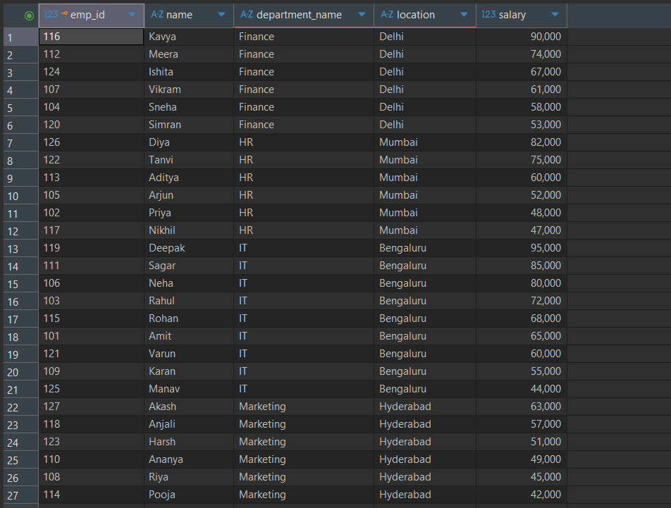
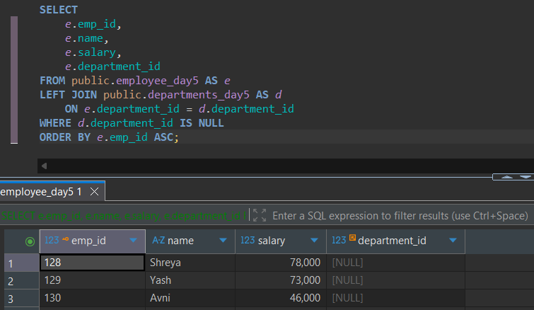
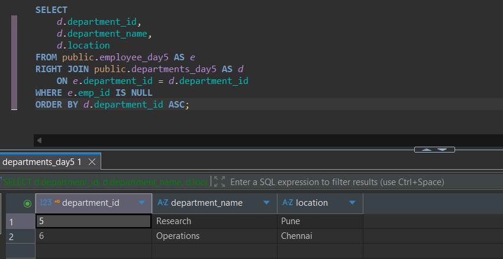
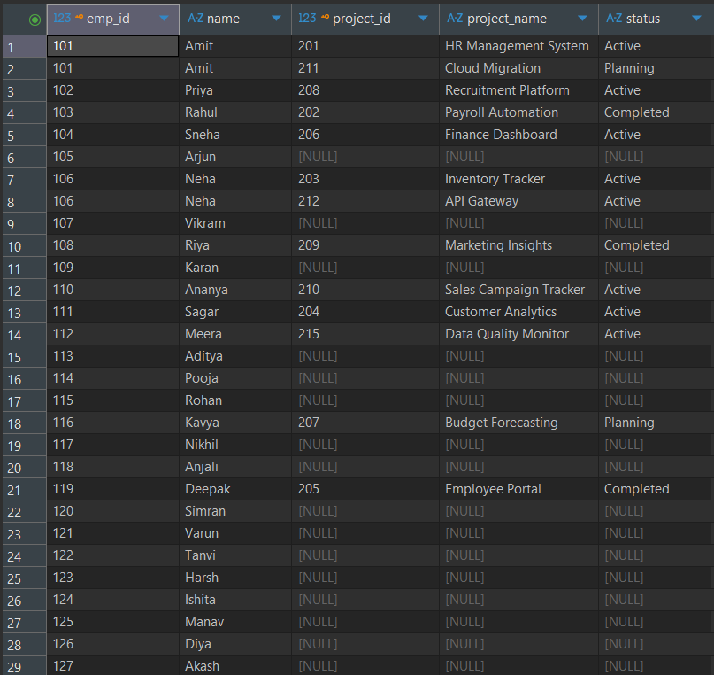
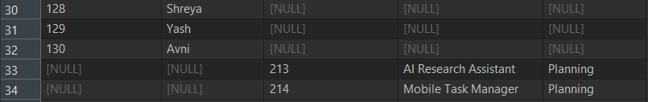
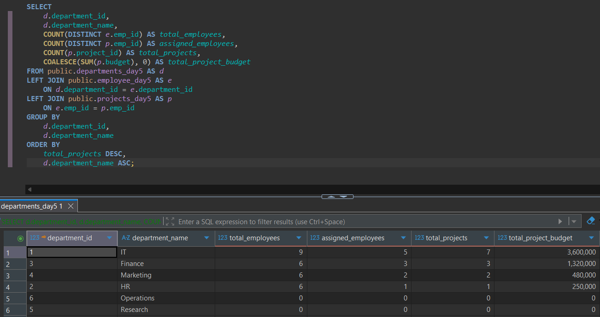

---
# Day 05: SQL Practice Answers

**Date:** 18 October 2026  
**Database:** PostgreSQL 18  
**Tool:** DBeaver  
**Topic:** SQL JOINs and Relational Data Retrieval  
**Tables:** `employee_day5`, `departments_day5`, `projects_day5`

---

## 1. Retrieve employees with their department details using INNER JOIN.

Retrieve:

- `emp_id`
- `name`
- `department_name`
- `location`
- `salary`

Include only employees with matching department records.

Sort by `department_name ASC`, followed by `salary DESC`, and then `emp_id ASC`.

**SQL Query**

```sql
SELECT
    e.emp_id,
    e.name,
    d.department_name,
    d.location,
    e.salary
FROM public.employee_day5 AS e
INNER JOIN public.departments_day5 AS d
    ON e.department_id = d.department_id
ORDER BY
    d.department_name ASC,
    e.salary DESC,
    e.emp_id ASC;
```

**Execution Output**



---

## 2. Identify employees without assigned departments using LEFT JOIN.

Retrieve:

- `emp_id`
- `name`
- `salary`
- `department_id`

Include only employees whose department is missing.

Use a `LEFT JOIN` and identify unmatched department records rather than filtering the employee table directly for NULL values.

Sort by `emp_id ASC`.

**SQL Query**

```sql
SELECT
    e.emp_id,
    e.name,
    e.salary,
    e.department_id
FROM public.employee_day5 AS e
LEFT JOIN public.departments_day5 AS d
    ON e.department_id = d.department_id
WHERE d.department_id IS NULL
ORDER BY e.emp_id ASC;
```

**Execution Output**



---

## 3. Identify departments without employees using RIGHT JOIN.

Retrieve:

- `department_id`
- `department_name`
- `location`

Use a `RIGHT JOIN` between employees and departments.

Include only departments having no matching employee records.

Sort by `department_id ASC`.

**SQL Query**

```sql
SELECT
    d.department_id,
    d.department_name,
    d.location
FROM public.employee_day5 AS e
RIGHT JOIN public.departments_day5 AS d
    ON e.department_id = d.department_id
WHERE e.emp_id IS NULL
ORDER BY d.department_id ASC;
```

**Execution Output**



---

## 4. Retrieve employee and project information using FULL OUTER JOIN.

Retrieve:

- `emp_id`
- `name`
- `project_id`
- `project_name`
- `status`

Include:

- Employees with assigned projects.
- Employees without assigned projects.
- Projects without assigned employees.

Sort by `emp_id ASC NULLS LAST`, followed by `project_id ASC NULLS LAST`.

**SQL Query**

```sql
SELECT
    e.emp_id,
    e.name,
    p.project_id,
    p.project_name,
    p.status
FROM public.employee_day5 AS e
FULL OUTER JOIN public.projects_day5 AS p
    ON e.emp_id = p.emp_id
ORDER BY
    e.emp_id ASC NULLS LAST,
    p.project_id ASC NULLS LAST;
```

**Execution Output**




---

## 5. Generate department-wise project assignment statistics using multiple JOINs.

For every department, retrieve:

- `department_id`
- `department_name`
- `total_employees` — number of distinct employees belonging to the department.
- `assigned_employees` — number of distinct employees with at least one assigned project.
- `total_projects` — number of projects assigned to employees in the department.
- `total_project_budget` — sum of project budgets assigned to employees in the department; display zero if no projects exist.

Include departments with no employees and departments whose employees have no projects.

Sort by `total_projects DESC`, followed by `department_name ASC`.

**SQL Query**

```sql
SELECT
    d.department_id,
    d.department_name,
    COUNT(DISTINCT e.emp_id) AS total_employees,
    COUNT(DISTINCT p.emp_id) AS assigned_employees,
    COUNT(p.project_id) AS total_projects,
    COALESCE(SUM(p.budget), 0) AS total_project_budget
FROM public.departments_day5 AS d
LEFT JOIN public.employee_day5 AS e
    ON d.department_id = e.department_id
LEFT JOIN public.projects_day5 AS p
    ON e.emp_id = p.emp_id
GROUP BY
    d.department_id,
    d.department_name
ORDER BY
    total_projects DESC,
    d.department_name ASC;
```

**Execution Output**



---

## Session Notes

- Practiced retrieving related records from multiple tables using SQL JOINs.
- Used `INNER JOIN` to retrieve employees with matching departments.
- Used `LEFT JOIN` to identify employees without assigned departments.
- Used `RIGHT JOIN` to identify departments without employees.
- Used `FULL OUTER JOIN` to retrieve matched and unmatched employee-project records.
- Combined multiple `LEFT JOIN` operations to generate department-wise project statistics.
- Applied `COUNT(DISTINCT)` to prevent duplicate employee counts.
- Used `COALESCE()` to display zero for departments without project budgets.
- Practiced identifying unmatched records using `IS NULL`.
- Applied multi-column sorting using `ORDER BY`.

### Additional Notes

- `JOIN` combines related rows from two or more tables using a matching condition.
- `INNER JOIN` returns only rows satisfying the join condition.
- `LEFT JOIN` preserves all rows from the left table, including unmatched rows.
- `RIGHT JOIN` preserves all rows from the right table, including unmatched rows.
- `FULL OUTER JOIN` preserves unmatched rows from both tables.
- `CROSS JOIN` produces every possible combination of rows from two tables.
- `INNER JOIN` and `JOIN` are equivalent in PostgreSQL.
- `LEFT JOIN` and `LEFT OUTER JOIN` are equivalent.
- `RIGHT JOIN` and `RIGHT OUTER JOIN` are equivalent.
- `FULL JOIN` and `FULL OUTER JOIN` are equivalent.
- The `ON` clause defines the condition used to match rows between tables.
- The `WHERE` clause filters rows after JOIN processing.
- Filtering an unmatched right-table column in `WHERE` can remove NULL-extended rows from a `LEFT JOIN`.
- A primary key uniquely identifies each record in a table.
- A foreign key establishes a reference to a primary or unique key in another table.
- A nullable foreign key allows records without an assigned parent row.
- `NULL` join keys do not match through ordinary equality comparisons.
- Table aliases such as `e`, `d`, and `p` make multi-table queries easier to read.
- One-to-many relationships can produce multiple joined rows for one parent record.
- `COUNT(*)` counts joined rows, including NULL-extended rows from outer joins.
- `COUNT(column)` ignores NULL values.
- `COUNT(DISTINCT e.emp_id)` counts unique employee IDs despite repeated project assignments.
- `COUNT(p.project_id)` counts projects without counting NULL-extended project rows.
- `COUNT(DISTINCT p.emp_id)` counts employees with at least one assigned project.
- `COALESCE(SUM(p.budget), 0)` returns zero when a department has no assigned project budgets.
- `GROUP BY` creates groups for department-wise aggregation.
- `NULLS LAST` places NULL values after non-NULL values when sorting.
- The order of tables matters for LEFT and RIGHT JOIN operations.
- Use fully qualified table names such as `public.employee_day5` to avoid schema confusion.

---
