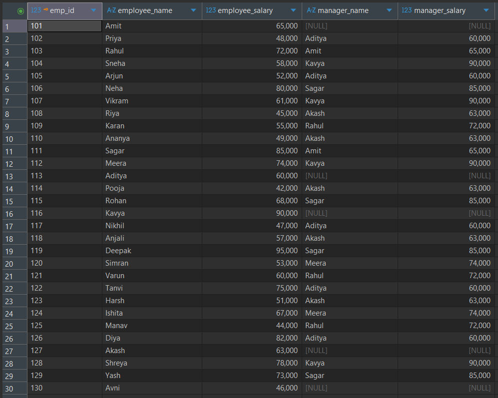
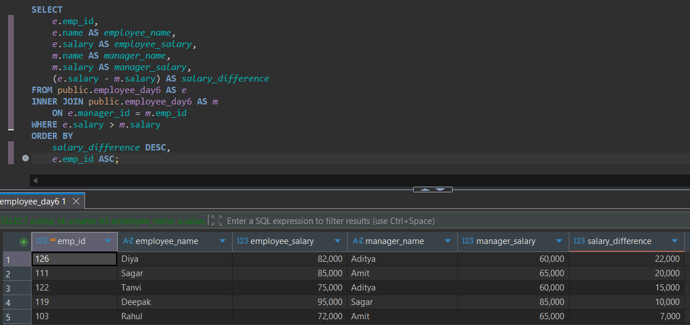
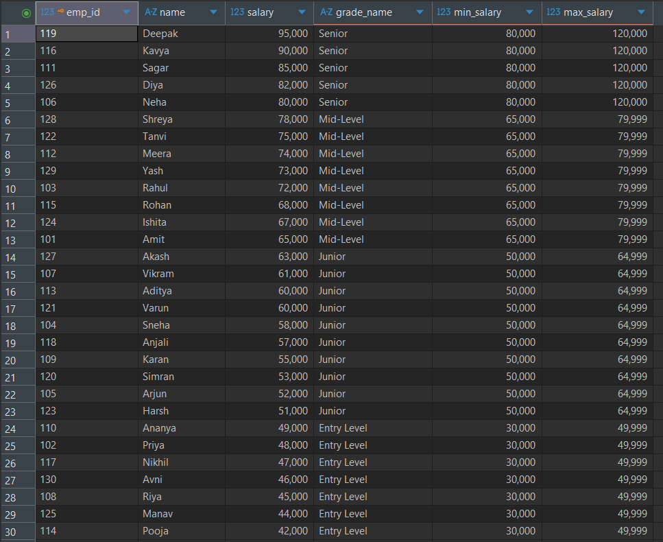
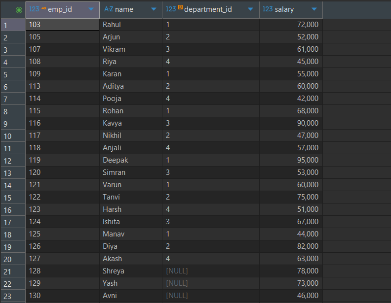
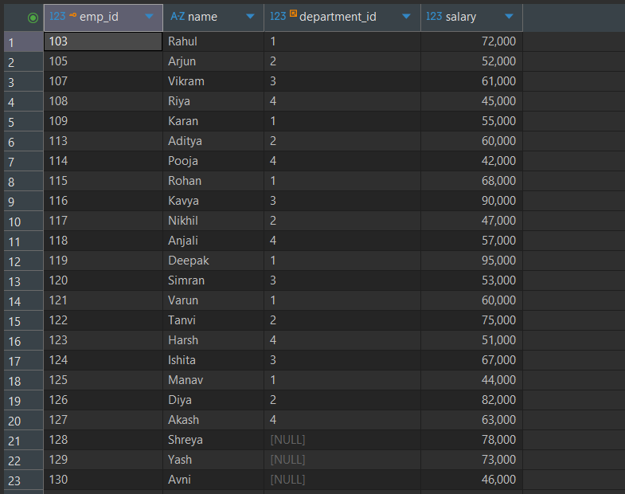

---
# Day 06: SQL Practice Answers

**Date:** 19 October 2026  
**Database:** PostgreSQL 18  
**Tool:** DBeaver  
**Topic:** Self JOINs and Advanced JOIN Conditions  
**Tables:** `employee_day6`, `departments_day6`, `salary_grades_day6`, `projects_day6`

---

## 1. Retrieve employees with their manager details using SELF JOIN.

Retrieve:

- `emp_id`
- `employee_name`
- `employee_salary`
- `manager_name`
- `manager_salary`

Include all employees, even those without assigned managers.

Sort by `emp_id ASC`.

**SQL Query**

```sql
SELECT
    e.emp_id,
    e.name AS employee_name,
    e.salary AS employee_salary,
    m.name AS manager_name,
    m.salary AS manager_salary
FROM public.employee_day6 AS e
LEFT JOIN public.employee_day6 AS m
    ON e.manager_id = m.emp_id
ORDER BY e.emp_id ASC;
```

**Explanation:**

- The employee table is referenced twice using aliases `e` and `m`.
- `e` represents employees, while `m` represents their managers.
- The JOIN matches `e.manager_id` with `m.emp_id`.
- `LEFT JOIN` includes employees who do not have managers.
- Employees without managers display NULL in the manager columns.

**Execution Output**



---

## 2. Identify employees earning more than their managers.

Retrieve:

- `emp_id`
- `employee_name`
- `employee_salary`
- `manager_name`
- `manager_salary`
- `salary_difference`

Include only employees whose salary is greater than their manager's salary.

Calculate `salary_difference` by subtracting the manager's salary from the employee's salary.

Sort by `salary_difference DESC`, followed by `emp_id ASC`.

**SQL Query**

```sql
SELECT
    e.emp_id,
    e.name AS employee_name,
    e.salary AS employee_salary,
    m.name AS manager_name,
    m.salary AS manager_salary,
    (e.salary - m.salary) AS salary_difference
FROM public.employee_day6 AS e
INNER JOIN public.employee_day6 AS m
    ON e.manager_id = m.emp_id
WHERE e.salary > m.salary
ORDER BY
    salary_difference DESC,
    e.emp_id ASC;
```

**Explanation:**

- `INNER JOIN` matches employees with their managers.
- The `WHERE` clause filters employees earning more than their managers.
- The calculated column `salary_difference` displays the salary gap.
- Employees without managers are excluded because no matching manager exists.
- Results are sorted by the highest salary difference first.

**Execution Output**



---

## 3. Assign salary grades using a Non-Equi JOIN.

Retrieve:

- `emp_id`
- `name`
- `salary`
- `grade_name`
- `min_salary`
- `max_salary`

Match employees with their salary grades using a range-based JOIN condition.

Include only employees whose salaries fall within a defined grade.

Sort by `salary DESC`, followed by `emp_id ASC`.

**SQL Query**

```sql
SELECT
    e.emp_id,
    e.name,
    e.salary,
    g.grade_name,
    g.min_salary,
    g.max_salary
FROM public.employee_day6 AS e
INNER JOIN public.salary_grades_day6 AS g
    ON e.salary BETWEEN g.min_salary AND g.max_salary
ORDER BY
    e.salary DESC,
    e.emp_id ASC;
```

**Explanation:**

- The JOIN uses a salary range rather than matching equal values.
- `BETWEEN` checks whether the employee's salary falls within the grade boundaries.
- Both minimum and maximum salary values are included.
- The salary grade ranges do not overlap, so each employee matches exactly one grade.
- Employees are sorted from highest salary to lowest.

**Execution Output**



---

## 4. Identify employees without active projects using an Anti-JOIN.

Retrieve:

- `emp_id`
- `name`
- `department_id`
- `salary`

Include employees who have no projects with `status = 'Active'`.

Employees assigned only to Completed or Planning projects must also be included.

Use `LEFT JOIN` with `IS NULL` or `NOT EXISTS`.

Sort by `emp_id ASC`.

**SQL Query — Method 1: LEFT JOIN with IS NULL**

```sql
SELECT
    e.emp_id,
    e.name,
    e.department_id,
    e.salary
FROM public.employee_day6 AS e
LEFT JOIN public.projects_day6 AS p
    ON e.emp_id = p.emp_id
   AND p.status = 'Active'
WHERE p.project_id IS NULL
ORDER BY e.emp_id ASC;
```

**Alternative SQL Query — Method 2: NOT EXISTS**

```sql
SELECT
    e.emp_id,
    e.name,
    e.department_id,
    e.salary
FROM public.employee_day6 AS e
WHERE NOT EXISTS (
    SELECT 1
    FROM public.projects_day6 AS p
    WHERE p.emp_id = e.emp_id
      AND p.status = 'Active'
)
ORDER BY e.emp_id ASC;
```

**Explanation:**

- Both queries identify employees without any Active projects.
- Method 1 matches only Active projects in the `ON` clause.
- Employees without matching Active projects receive NULL project values.
- `WHERE p.project_id IS NULL` selects those unmatched employees.
- Method 2 uses `NOT EXISTS` to check that no Active project exists for each employee.
- Employees with only Completed or Planning projects are included.
- Both methods produce the same result for this dataset.

**Execution Output**



---

## 5. Find unique employee pairs working in the same department.

Retrieve:

- `department_name`
- `employee_one`
- `employee_two`
- `employee_one_salary`
- `employee_two_salary`
- `salary_difference`

Include only employee pairs belonging to the same department.

Avoid pairing employees with themselves and returning reversed duplicate pairs.

Include only pairs whose absolute salary difference is at least 15,000.

Sort by `salary_difference DESC`, followed by `department_name ASC`, `employee_one ASC`, and `employee_two ASC`.

**SQL Query**

```sql
SELECT
    d.department_name,
    e1.name AS employee_one,
    e2.name AS employee_two,
    e1.salary AS employee_one_salary,
    e2.salary AS employee_two_salary,
    ABS(e1.salary - e2.salary) AS salary_difference
FROM public.employee_day6 AS e1
INNER JOIN public.employee_day6 AS e2
    ON e1.department_id = e2.department_id
   AND e1.emp_id < e2.emp_id
INNER JOIN public.departments_day6 AS d
    ON e1.department_id = d.department_id
WHERE ABS(e1.salary - e2.salary) >= 15000
ORDER BY
    salary_difference DESC,
    d.department_name ASC,
    employee_one ASC,
    employee_two ASC;
```

**Explanation:**

- `e1` and `e2` represent two different references to the employee table.
- The first JOIN matches employees belonging to the same department.
- `e1.emp_id < e2.emp_id` prevents self-pairs and reversed duplicate pairs.
- The second JOIN retrieves the corresponding department name.
- `ABS()` calculates the absolute salary difference.
- The `WHERE` clause includes only pairs with a salary difference of at least 15,000.
- Results are sorted by the largest salary difference first.

**Execution Output**



---

## Session Notes

- Practiced SELF JOINs using employee-manager relationships.
- Retrieved employee and manager details using table aliases.
- Used INNER JOIN and LEFT JOIN with the same table.
- Compared employee salaries against manager salaries.
- Calculated salary differences using arithmetic expressions.
- Implemented Non-Equi JOINs using BETWEEN.
- Matched employees with salary grades based on salary ranges.
- Practiced Anti-JOIN patterns to identify employees without Active projects.
- Compared LEFT JOIN with IS NULL against NOT EXISTS.
- Applied multiple JOIN conditions using AND.
- Used ABS() to calculate absolute salary differences.
- Generated unique employee pairs within the same department.
- Prevented reversed duplicate pairs using inequality conditions.
- Combined SELF JOIN and INNER JOIN in a multi-table query.

### Additional Notes

- SELF JOIN is a technique for joining a table with itself.
- SELF JOIN does not have a separate SQL keyword.
- Table aliases distinguish multiple references to the same table.
- A self-referencing foreign key establishes hierarchical relationships.
- `LEFT JOIN` preserves employees without managers.
- `INNER JOIN` excludes employees without matching managers.
- `e.manager_id = m.emp_id` matches employees with their managers.
- Calculated columns can use arithmetic expressions.
- Non-Equi JOINs use conditions other than equality.
- `BETWEEN` includes both boundary values.
- Non-overlapping salary ranges prevent multiple grade matches.
- Composite JOIN conditions combine multiple expressions using AND or OR.
- Conditions inside `ON` determine how rows are matched.
- Conditions inside `WHERE` filter the joined result.
- Moving a condition from ON to WHERE can change OUTER JOIN results.
- Anti-JOIN patterns identify records without matching relationships.
- `LEFT JOIN ... IS NULL` is commonly used for anti-joins.
- `NOT EXISTS` checks whether a correlated subquery returns no rows.
- `NOT IN` requires careful NULL handling.
- `ABS()` returns the absolute value of a numeric expression.
- `e1.emp_id < e2.emp_id` prevents self-pairs and reversed duplicate pairs.
- Multiple JOIN operations can be combined within one SQL statement.
- Correct JOIN conditions prevent unintended duplicate records.
- Indexes on frequently joined columns can improve query performance.
- Recursive CTEs are useful for traversing multi-level hierarchies.

---
