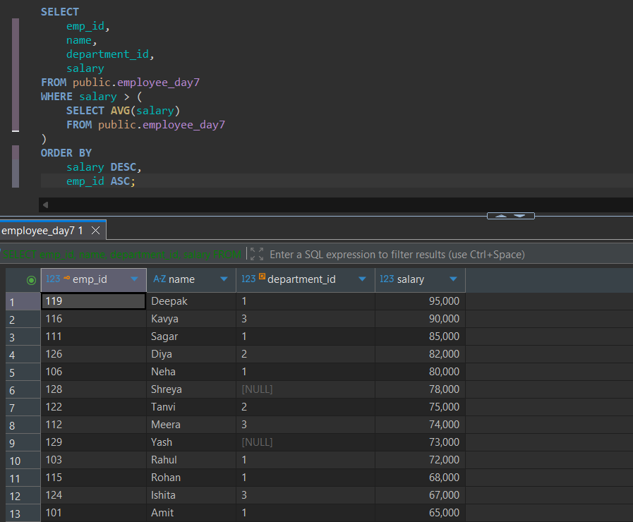
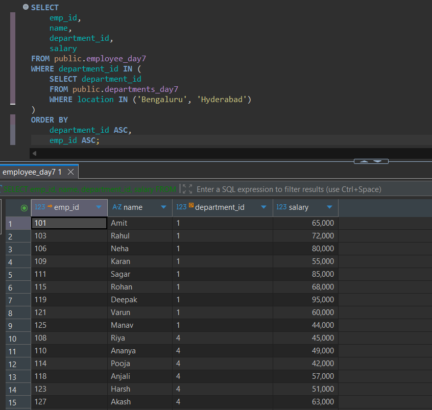
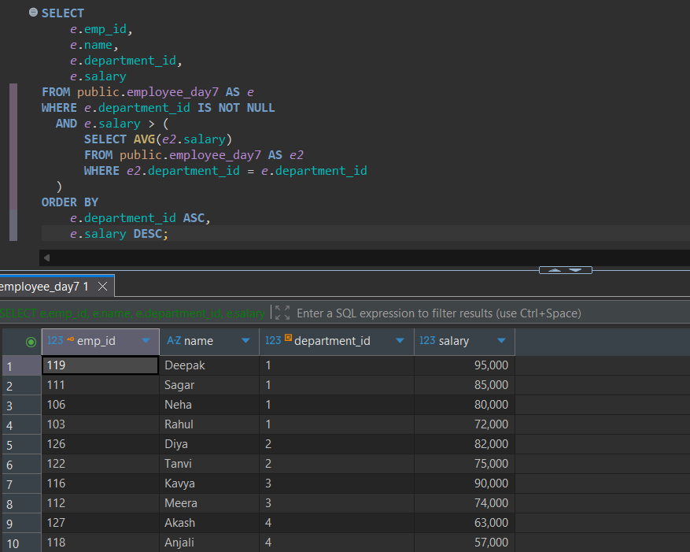
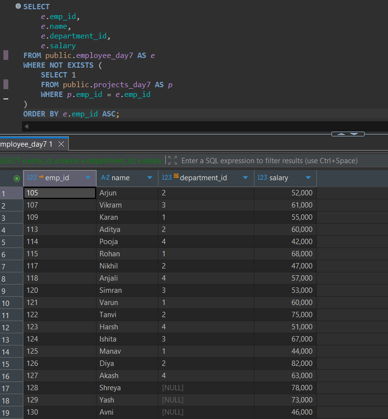
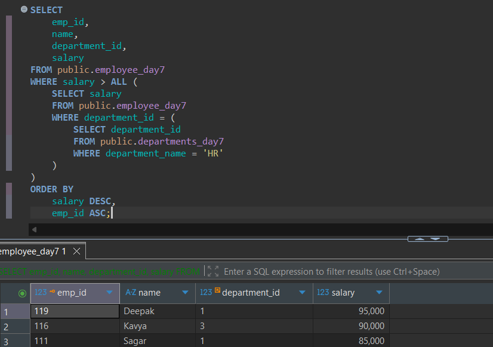

# Day 07: SQL Practice Answers

**Date:** 20 October 2026  
**Database:** PostgreSQL 18  
**Tool:** DBeaver  
**Topic:** SQL Subqueries  
**Tables:** `employee_day7`, `departments_day7`, `projects_day7`

---

## 1. Find employees earning above the company average salary.

Retrieve:
- `emp_id`
- `name`
- `department_id`
- `salary`

**Conditions:**
- Use a scalar subquery.
- Include employees earning strictly above the overall average salary.
- Sort by `salary DESC`, then `emp_id ASC`.

**SQL Query**

```sql
SELECT
    emp_id,
    name,
    department_id,
    salary
FROM public.employee_day7
WHERE salary > (
    SELECT AVG(salary)
    FROM public.employee_day7
)
ORDER BY
    salary DESC,
    emp_id ASC;
```

**Explanation:**

The scalar subquery calculates the overall average salary. The outer query returns employees earning more than that average.

**Execution Output**



---

## 2. Find employees working in departments located in Bengaluru or Hyderabad.

Retrieve:
- `emp_id`
- `name`
- `department_id`
- `salary`

**Conditions:**
- Use a multi-row subquery with `IN`.
- Retrieve department IDs from the departments table.
- Do not use JOIN.
- Sort by `department_id ASC`, then `emp_id ASC`.

**SQL Query**

```sql
SELECT
    emp_id,
    name,
    department_id,
    salary
FROM public.employee_day7
WHERE department_id IN (
    SELECT department_id
    FROM public.departments_day7
    WHERE location IN ('Bengaluru', 'Hyderabad')
)
ORDER BY
    department_id ASC,
    emp_id ASC;
```

**Explanation:**

The inner query retrieves department IDs located in Bengaluru or Hyderabad. The outer query returns employees belonging to those departments.

**Execution Output**



---

## 3. Find employees earning above their department's average salary.

Retrieve:
- `emp_id`
- `name`
- `department_id`
- `salary`

**Conditions:**
- Use a correlated subquery.
- Compare each employee's salary with their department's average.
- Exclude employees without departments.
- Sort by `department_id ASC`, then `salary DESC`.

**SQL Query**

```sql
SELECT
    e.emp_id,
    e.name,
    e.department_id,
    e.salary
FROM public.employee_day7 AS e
WHERE e.department_id IS NOT NULL
  AND e.salary > (
      SELECT AVG(e2.salary)
      FROM public.employee_day7 AS e2
      WHERE e2.department_id = e.department_id
  )
ORDER BY
    e.department_id ASC,
    e.salary DESC;
```

**Explanation:**

The correlated subquery calculates the average salary for the current employee's department. The outer query returns employees earning above that department-specific average.

**Execution Output**



---

## 4. Find employees who are not assigned to any project.

Retrieve:
- `emp_id`
- `name`
- `department_id`
- `salary`

**Conditions:**
- Use `NOT EXISTS`.
- Include employees without any project assignments.
- Exclude employees assigned to Active, Completed, or Planning projects.
- Sort by `emp_id ASC`.

**SQL Query**

```sql
SELECT
    e.emp_id,
    e.name,
    e.department_id,
    e.salary
FROM public.employee_day7 AS e
WHERE NOT EXISTS (
    SELECT 1
    FROM public.projects_day7 AS p
    WHERE p.emp_id = e.emp_id
)
ORDER BY e.emp_id ASC;
```

**Explanation:**

The correlated subquery checks for projects assigned to each employee. `NOT EXISTS` returns only employees for whom no project record exists, regardless of project status.

**Execution Output**



---

## 5. Find employees earning more than every employee in the HR department.

Retrieve:
- `emp_id`
- `name`
- `department_id`
- `salary`

**Conditions:**
- Use a nested subquery to identify the HR department.
- Use `ALL` to compare salaries.
- Include employees from any department who satisfy the condition.
- Sort by `salary DESC`, then `emp_id ASC`.

**SQL Query**

```sql
SELECT
    emp_id,
    name,
    department_id,
    salary
FROM public.employee_day7
WHERE salary > ALL (
    SELECT salary
    FROM public.employee_day7
    WHERE department_id = (
        SELECT department_id
        FROM public.departments_day7
        WHERE department_name = 'HR'
    )
)
ORDER BY
    salary DESC,
    emp_id ASC;
```

**Explanation:**

The innermost subquery identifies the HR department. The next subquery retrieves HR employee salaries. `> ALL` selects employees whose salaries exceed every HR salary.

**Execution Output**



---

## Session Notes

- Practiced scalar, multi-row, correlated, and nested subqueries.
- Used `AVG()` inside a scalar subquery.
- Filtered records using `IN` with a multi-row subquery.
- Compared salaries against department-specific averages.
- Used `NOT EXISTS` to identify employees without projects.
- Applied `ALL` to compare salaries against an entire result set.
- Practiced using subqueries without JOIN operations.
- Used table aliases to reference outer-query columns.

### Additional Notes

- A subquery is a query nested inside another SQL statement.
- Subqueries can appear in SELECT, FROM, WHERE, and HAVING.
- Scalar subqueries return at most one row and one column.
- Multi-row subqueries can be used with IN, ANY, and ALL.
- Correlated subqueries reference columns from the outer query.
- Non-correlated subqueries can execute independently.
- `IN` checks membership in a result set.
- `EXISTS` checks whether a subquery returns at least one row.
- `NOT EXISTS` checks whether a subquery returns no rows.
- `NOT IN` requires caution when NULL values are present.
- `> ANY` means greater than at least one returned value.
- `> ALL` means greater than every returned value.
- `AVG()` ignores NULL values.
- `NOT EXISTS` can identify missing relationships without a JOIN.
- Nested subqueries can contain multiple levels.
- Subqueries and JOINs can sometimes solve the same problem.
- PostgreSQL may optimize subqueries into efficient execution plans.

---
